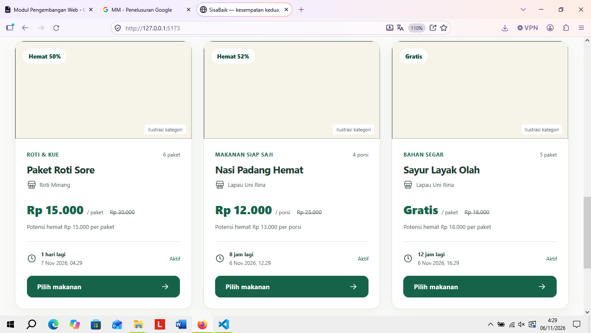
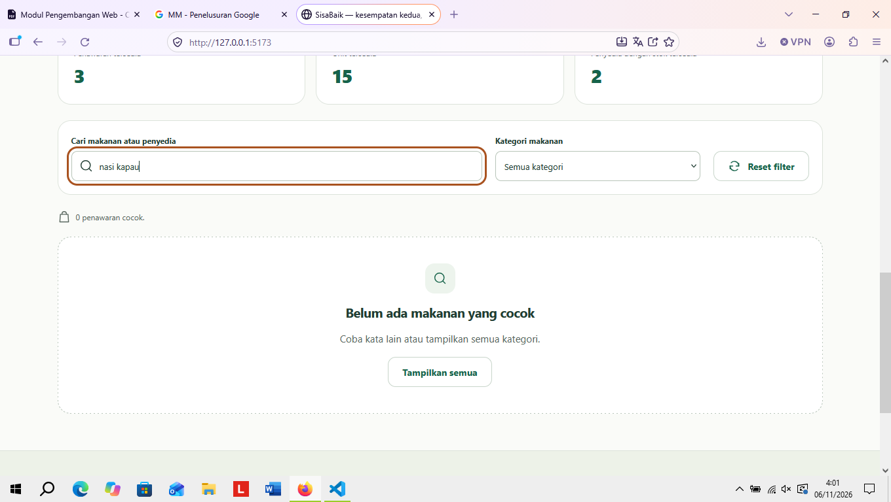
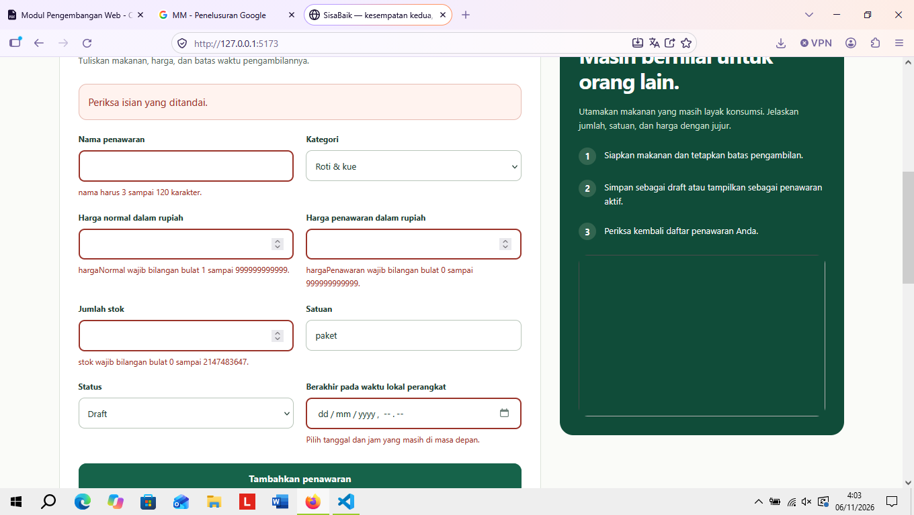
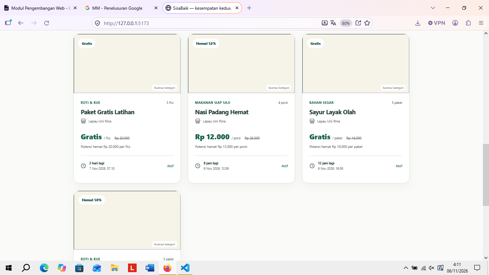
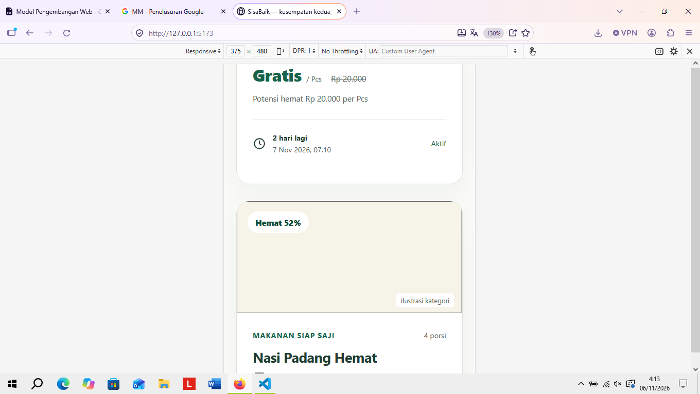
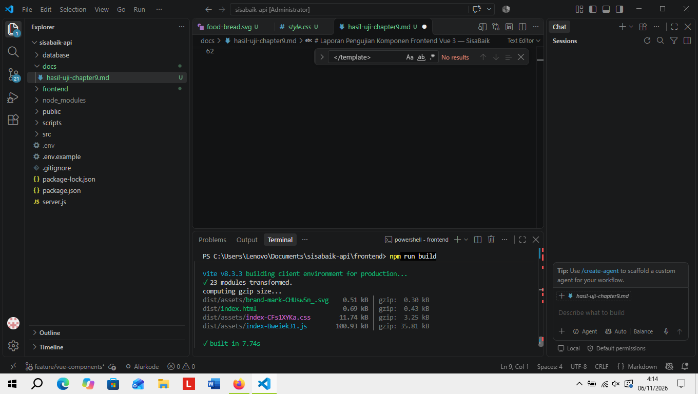

# Laporan Pengujian Komponen Frontend Vue 3 — SisaBaik

**Penguji:** Syaifullah Hidayat  
**NIM:** 23367052  
**Tanggal Pengujian:** 6 November 2026  
**Versi Perangkat:** Node.js v24.16.0
---

## 1. Aliran Data Reaktif (Props dan Emits)
Pada implementasi Chapter 9 ini, arsitektur aliran data diatur dengan prinsip *Data Props Turun, Event Emits Naik*:
* **Props (Induk ke Anak):** Komponen `App.vue` bertindak sebagai pemilik *state* utama (data penawaran, filter pencarian, dan kategori). Data ini dialirkan ke bawah ke komponen anak (`FilterPenawaran.vue` dan `KartuPenawaran.vue`) sebagai read-only melalui properti binding (`:pencarian`, `:kategori`, `:penawaran`).
* **Emits (Anak ke Induk):** Ketika pengguna berinteraksi dengan komponen anak (misalnya mengetik di kolom pencarian atau memilih makanan), komponen anak tidak mengubah data secara langsung. Anak mengirimkan sinyal ke atas menggunakan macro `defineEmits` (`ubah-pencarian`, `ubah-kategori`, `pilih`). Komponen induk (`App.vue`) menangkap sinyal tersebut dan memperbarui *state* reaktifnya di memori lokal.

---

## 2. Perhitungan Ringkasan (Computed Properties)
Semua angka ringkasan dihitung secara dinamis menggunakan properti `computed` berbasis perubahan *state* reaktif:
* **Ringkasan Pembeli:** Diperoleh dengan menyaring array `penawaran` lewat helper `tersedia()` (status aktif, stok > 0, dan belum kedaluwarsa). Filter pencarian tidak mengubah total unit reaktif keseluruhan karena total diambil langsung dari basis data penawaran yang aktif.
* **Ringkasan Penyedia:** Menggunakan computed `milikRina` untuk menyaring penawaran berdasarkan `penyediaId === '1'`. Ini menghitung seluruh total penawaran termasuk yang berstatus *draft*.

---

## 3. Tabel Skenario Pengujian Aktual

| **Skenario Pengujian** | **Hasil Ekspektasi** | **Hasil Aktual** | **Penjelasan & Bukti Aliran Data** |
|---|---|---|---|
| **Halaman baru, mode pembeli** | 3 kartu; 15 unit; 2 penyedia | **BERHASIL** | Hanya menampilkan data penawaran yang aktif, stok positif, dan belum kedaluwarsa dari memori. |
| **Pencarian kata "LAPAU"** | Dua kartu penawaran Lapau Uni Rina | **BERHASIL** | Pencarian tidak peka huruf besar (*case-insensitive*) untuk kolom nama makanan dan nama usaha. |
| **Pencarian tidak-ada-produk** | Daftar kosong dan pesan kecocokan | **BERHASIL** | Direktif `v-if` dan `v-else` bekerja sempurna mengikuti hasil filter computed katalog yang kosong. |
| **Reset filter lalu pilih kategori roti** | Satu kartu Paket Roti Sore | **BERHASIL** | Event anak berhasil memperbarui state filter induk, lalu mengalirkan array props baru ke komponen kartu. |
| **Pilih kartu "Paket Roti Sore"** | Ringkasan mendapat fokus; stok tetap 6 | **BERHASIL** | Event pilih ditangkap induk untuk panel demonstrasi. Klik ini terbukti belum membuat pesanan baru ke server. |
| **Beralih ke mode penyedia** | 3 kartu Rina; 2 tersedia; 9 unit | **BERHASIL** | Menu berstatus *Draft* tetap ditampilkan. Penghitungan ketersediaan hanya mencakup data milik usaha Rina. |
| **Submit form kosong** | Kesalahan mendapat fokus; daftar tetap 3 | **BERHASIL** | Payload form ditolak oleh validator JavaScript lokal, data tidak di-emit ke induk, dan fokus pindah ke ringkasan eror. |
| **Isi harga normal 20000 & penawaran 30000** | Kesalahan harga muncul; daftar tidak bertambah | **BERHASIL** | Validator frontend sukses memeriksa hubungan antar-field di mana harga penawaran tidak boleh melebihi harga normal. |
| **Isi Form Valid (Paket Gratis Latihan, harga 0, stok 2)** | Data Rina bertambah; form kosong; angka 4 / 3 / 11 | **BERHASIL** | Harga 0 dibaca sebagai label "Gratis". Form melakukan emit data valid, induk melakukan `unshift` ke awal array state. |
| **Kembali ke pembeli & reset filter** | 4 kartu; 17 unit; 2 penyedia | **BERHASIL** | Computed katalog pembeli langsung mendeteksi dan memperbarui tampilan dari array penawaran terbaru secara dinamis. |
| **Beralih kembali ke penyedia** | Form kosong, data baru yang tadi diinput masih ada | **BERHASIL** | State formulir lokal terbukti bersih kembali (*isolated*) tanpa mengganggu data penawaran baru yang sudah masuk ke induk. |
| **Refresh browser** | Kembali ke 3 kartu awal; 15 unit; 2 penyedia | **BERHASIL** | Seluruh data kembali ke awal. Menandakan data penawaran baru disimpan di RAM browser, belum permanen di PostgreSQL. |

---

## 4. Lampiran Bukti Gambar (Screenshots)

### A. Tampilan Halaman Depan (Katalog Pembeli Awal)

### B. Tampilan Halaman Kosong (Empty State Pencarian)

### C. Validasi Formulir Gagal (Form Invalid Error)

### D. Penambahan Penawaran Berhasil (Form Valid)

### E. Pemeriksaan Responsivitas Tampilan Mobile (Lebar 375px)

### F. Hasil Perintah Kompilasi Berhasil (Terminal Build VS Code)

